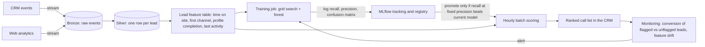

# Lead-conversion prediction

An online-learning startup gets more leads than its sales team can call. I built a model that ranks which leads are likely to pay, and found what drives conversion: **time on the website, a website first touch, and referrals**. The final model, a tuned random forest, finds **85% of the leads who convert** on held-out data.

| | |
|---|---|
| Technique | Classification: decision tree and random forest, grid search tuned for recall |
| Data | 4,612 leads, about 30% converted ([schema](data/README.md); not public) |
| Result | Tuned random forest: recall 0.85, precision 0.67, accuracy 0.83 on 1,384 test leads |
| Stack | Python, pandas, scikit-learn, Matplotlib, seaborn |

> **Where the numbers come from.** Every number in this README comes from my original run of the analysis (Google Colab, 2026), copied from the executed notebook's outputs. The dataset was course material and isn't public, so it isn't in this repo and I haven't re-run the rebuilt code on it. With a copy of the file, `make reproduce` re-runs everything and checks the results against [`results/reference_metrics.json`](results/reference_metrics.json). Without it, `make demo` runs the same pipeline on synthetic data.

## Business problem

An early-stage online-learning company generates leads from its website, mobile app, print and digital ads, education forums and referrals. Its sales team can't follow up with all of them quickly. The business needs to know **which leads are most likely to become paying customers** and **what drives conversion**, so it can spend sales time and marketing budget where they pay off.

## Data

4,612 leads, 14 attributes after dropping the ID: age, occupation, first interaction (website or mobile app), profile completion, website visits, time on the website, pages per visit, last activity (email, phone, website), five marketing-channel flags, and whether the lead converted. No missing values, no duplicate rows. About 30% converted (1,377 of 4,612).

## Approach

1. **Explored conversion by segment.** Professionals converted most often, then unemployed leads, then students. Website-first leads converted far more often than mobile-app leads. Email and website activity beat phone follow-up. High profile completion converted best.
2. **Measured channel conversion** (among leads who saw each channel):

   | Channel | Leads | Converted | Rate |
   |---|---|---|---|
   | Referral | 93 | 63 | **67.7%** |
   | Magazine | 233 | 75 | 32.2% |
   | Newspaper | 497 | 159 | 32.0% |
   | Digital ads | 527 | 168 | 31.9% |
   | Education channels | 705 | 197 | 27.9% |

3. **Prepared the data.** One-hot encoded the categorical fields (16 features) and split 70/30, stratified on conversion: 3,228 training and 1,384 test leads.
4. **Built baselines and diagnosed them.** The default decision tree and random forest both scored 1.00 on training data and much lower on test data: classic overfitting.
5. **Pruned and tuned for recall** with grid search: 5-fold cross-validation for the tree, 3-fold for the forest.
6. **Read the models.** Printed the pruned tree's rules and the forest's feature importances, and turned them into actions.

## Results

Test set of 1,384 leads; precision, recall and F1 are for the converted class. Source: original run.

| Model | Accuracy | Recall (buyers found) | Precision | F1 | Train accuracy |
|---|---|---|---|---|---|
| Decision tree, default, balanced weights | 0.79 | 0.63 | 0.66 | 0.64 | 1.00 |
| Decision tree, pruned (depth 3, balanced) | 0.78 | 0.89 | 0.58 | 0.70 | 0.79 |
| Random forest, default, balanced weights | 0.86 | 0.72 | 0.79 | 0.76 | 1.00 |
| **Random forest, tuned** (100 trees, depth 5, min leaf 5, min split 20, balanced) | **0.83** | **0.85** | **0.67** | **0.75** | 0.85 |

**What drives conversion**

- **Time on the website** is the strongest signal. The pruned tree splits at 414 to 420 seconds: roughly **7 minutes**.
- **A website first touch** beats the mobile app. Mobile-app leads are only predicted to convert when they later show strong website engagement.
- **Profile completion** matters: high completion converts best.
- **Referrals** convert at more than twice the rate of any other channel, but only 93 of 4,612 leads came from referrals.
- Age, number of visits and pages per visit matter much less.

**What I'd tell the business**

- **Sales:** call website-first leads with 7+ minutes on the site first. The tuned model's list catches 85% of eventual buyers, and about two in three leads it flags convert.
- **Marketing:** grow the referral program (incentives, alumni referrals); it converts best but is the smallest channel. Make profile completion easier, and invest in website content that keeps people reading.
- **Product:** find out why mobile-app leads convert less; the app may lose people before they reach what they need.

## Decisions and trade-offs

**Optimize recall on converters, not accuracy.** A missed buyer is lost revenue; an extra call costs a few minutes. Accuracy would also look good on a model that ignores the 30% minority.

**The tuned forest over the highest-recall tree.** The pruned tree finds the most buyers (0.89) but only 58% of the leads it flags convert. The tuned forest gives up 4 points of recall for 9 points of precision. Against the most accurate model (default forest, 0.86 accuracy) it finds 13 points more buyers. About one in three flagged leads won't convert, which costs calls; the right threshold should be set with sales using real call costs and deal values, which aren't in the data.

**Keep the simple tree for explanation.** Sales won't act on a black box. The depth-3 tree's rules ("website first, 7+ minutes") are what a team remembers; the forest makes the predictions. The explanation is approximate, and I say so.

**Balanced class weights, chosen by the search.** Each grid search could keep or drop balanced weights; both winners kept them.

**Known weakness:** I compared all four models on the same test set, so the tuned forest's scores are somewhat optimistic. Next time I'd choose on cross-validated scores and keep the test set for one final number.

**What I changed when I rebuilt the code** (none of these should change the reported results; `make reproduce` checks): rewrote the plotting and reporting helpers, fixed the confusion-matrix labels, and added schema validation that rejects unknown category values before modeling.

## How to run

```bash
make setup && source .venv/bin/activate   # Python 3.12+; pinned versions tested on 3.14
make test                                 # unit tests on synthetic data
make demo                                 # full pipeline on synthetic data
# With a copy of the dataset at data/raw/leads.csv:
make reproduce                            # writes results/metrics.json and compares with the original run
make notebook                             # runs notebooks/lead_conversion.ipynb top to bottom
```

## Repo layout

```
src/leadscore/
  config.py      seed, split, column lists, search grids
  data.py        load and validate the leads file
  analysis.py    conversion rates by segment and channel
  features.py    one-hot encoding and stratified split
  train.py       default and tuned decision tree and random forest
  evaluate.py    scores, confusion matrix, feature importance, tree rules
  pipeline.py    end-to-end run and comparison with the reference run (CLI)
  synthetic.py   fake leads with the real schema, for tests and demos
notebooks/lead_conversion.ipynb   the analysis, step by step
results/reference_metrics.json    numbers from the original run
tests/                            pytest suite
```

## In production on Databricks (design)

This is how I would run it in production. It's a design, not something I have deployed.



- **Pipeline:** stream CRM and web-analytics events into Delta tables and build one lead-level feature row in Silver.
- **Features:** a lead feature table in the feature store, shared by training and scoring so they never drift apart.
- **Training and tracking:** the grid search and the final forest logged in MLflow with recall, precision and the confusion matrix per run; a model is promoted only if its recall at a fixed precision (or within the team's call budget) on a holdout beats the current one.
- **Serving:** score new leads every hour and write a ranked list to the CRM.
- **Monitoring:** track weekly conversion of flagged vs. unflagged leads and the feature distributions; alert when recall on recently closed leads drops below an agreed floor.

## What I'd do next

- Tune the probability threshold with sales against real costs (cost of a call vs. value of a sale) instead of the default 0.5.
- Try gradient-boosted trees and calibrate the probabilities so scores read as likelihoods.
- Check the time-on-site signal for leakage: if long sessions happen *after* a sales conversation, the model is partly seeing the outcome.
- Run a controlled trial: half the team uses the ranked list for a month; compare conversion per call.

## About

I built this project in the AI & Data Science Program: Leveraging Responsible AI, Data and Statistics for Practical Impact (MIT IDSS, delivered through Great Learning), 2026. The analysis, code and write-up are my own. Code is MIT licensed.
